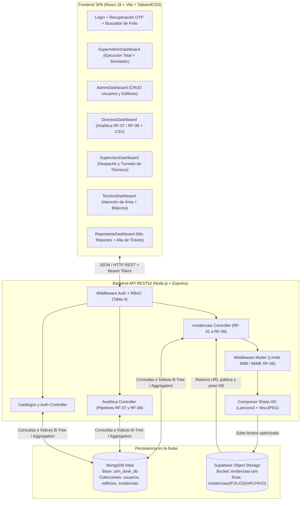

# Documentación Técnica Integral: UTM Desk NoSQL Cloud

**Proyecto:** Sistema Integral de Gestión, Resolución y Analítica de Incidencias en el Campus (UTM Desk NoSQL Cloud)  
**Institución:** Universidad Tecnológica Metropolitana (UTM)  
**Arquitectura:** Persistencia Políglota en la Nube (MongoDB Atlas + Supabase Object Storage) + API RESTful Node.js/Express + SPA React 18  

---

## Índice General

1. [Resumen Ejecutivo de Cambios y Mejoras](#1-resumen-ejecutivo-de-cambios-y-mejoras)
2. [Arquitectura General del Sistema y Estructura del Proyecto](#2-arquitectura-general-del-sistema-y-estructura-del-proyecto)
3. [Creación, Modelado y Configuración de Bases de Datos](#3-creacion-modelado-y-configuracion-de-bases-de-datos)
   - 3.1. [MongoDB Atlas (`utm_desk_db`): Configuración y Conexión](#31-mongodb-atlas-utm_desk_db-configuracion-y-conexion)
   - 3.2. [Diseño de las 3 Colecciones NoSQL (`usuarios`, `edificios`, `incidencias`)](#32-diseno-de-las-3-colecciones-nosql-usuarios-edificios-incidencias)
   - 3.3. [Indexación Estratégica en MongoDB (Tabla 8 del ERS)](#33-indexacion-estrategica-en-mongodb-tabla-8-del-ers)
   - 3.4. [Supabase Storage (`evidencias-utm`) y Vinculación con MongoDB](#34-supabase-storage-evidencias-utm-y-vinculacion-con-mongodb)
   - 3.5. [Motor de Compresión Inteligente de Imágenes (`Sharp` HD)](#35-motor-de-compresion-inteligente-de-imagenes-sharp-hd)
4. [Programación del Backend, Seguridad y Reglas de Negocio](#4-programacion-del-backend-seguridad-y-reglas-de-negocio)
   - 4.1. [Seguridad: Hashing `bcrypt`, Tokens Firmados y Recuperación de Contraseña](#41-seguridad-hashing-bcrypt-tokens-firmados-y-recuperacion-de-contrasena)
   - 4.2. [Control de Acceso Basado en Roles (RBAC — Tabla 3 y Tabla 4)](#42-control-de-acceso-basado-en-roles-rbac--tabla-3-y-tabla-4)
   - 4.3. [Gestión de Folios (`INC-AAAA-NNNN`) y Ciclo de Vida de Tickets (`RF-01` a `RF-06`)](#43-gestion-de-folios-inc-aaaa-nnnn-y-ciclo-de-vida-de-tickets-rf-01-a-rf-06)
   - 4.4. [Motor de Analítica con Pipelines de Agregación (`RF-07` y `RF-08`)](#44-motor-de-analitica-con-pipelines-de-agregacion-rf-07-y-rf-08)
   - 4.5. [Catálogo Completo de Endpoints RESTful](#45-catalogo-completo-de-endpoints-restful)
5. [Programación del Frontend y las 6 Interfaces por Rol](#5-programacion-del-frontend-y-las-6-interfaces-por-rol)
   - 5.1. [Interfaz Super Admin (`SuperAdminDashboard.jsx`)](#51-interfaz-super-admin-superadmindashboardjsx)
   - 5.2. [Interfaz Administrador (`AdminDashboard.jsx`)](#52-interfaz-administrador-admindashboardjsx)
   - 5.3. [Interfaz Directivo (`DirectivoDashboard.jsx`)](#53-interfaz-directivo-directivodashboardjsx)
   - 5.4. [Interfaz Supervisor (`SupervisorDashboard.jsx`)](#54-interfaz-supervisor-supervisordashboardjsx)
   - 5.5. [Interfaz Técnico (`TecnicoDashboard.jsx`)](#55-interfaz-tecnico-tecnicodashboardjsx)
   - 5.6. [Interfaz Reportante (`ReportanteDashboard.jsx`)](#56-interfaz-reportante-reportantedashboardjsx)
   - 5.7. [Componentes Transversales (Login, Rastreador de Folio, Recuperación, Expediente)](#57-componentes-transversales-login-rastreador-de-folio-recuperacion-expediente)
6. [Semilla de Datos (`seedData.js`), Credenciales y Comandos de Operación](#6-semilla-de-datos-seeddatajs-credenciales-y-comandos-de-operacion)

---

## 1. Resumen Ejecutivo de Cambios y Mejoras

A lo largo del desarrollo y alineación con el documento de especificación oficial (**ERS UTM Desk NoSQL Cloud**), se diseñaron, programaron e integraron los siguientes módulos y mejoras:

1. **Conexión Real y Resiliente a MongoDB Atlas (`utm_desk_db`)**:
   - Se configuró la conexión en la nube con pooling de conexiones (`maxPoolSize: 10`), detección automática de `.env` independientemente del directorio de ejecución y modo de respaldo en memoria en caso de pérdida de red.
2. **Alineación 100% con el Esquema Documental y Nomenclatura del ERS**:
   - Se sincronizaron de forma transparente todos los nombres de campos exigidos en el documento oficial (`correo`, `creadoEn`, `clave`, `aulas`, `ubicacion.edificioId`, `ubicacion.aula`, `reportadoPor`, `asignadoA`, `fechaReporte`, `fechaResolucion`, `tiempoResolucionMin`, `revisiones.comentario`, `revisiones.estadoAnterior`, `revisiones.estadoNuevo`) con los campos utilizados por la interfaz gráfica.
3. **Creación de los 4 Índices Oficiales de la Tabla 8**:
   - Se declararon y construyeron en MongoDB Atlas los índices `idx_codigo_unico`, `idx_categoria_estado`, `idx_ubicacion_historial` e `idx_fecha_reporte`.
4. **Integración con Supabase Storage + Compresor Inteligente HD (`Sharp`)**:
   - Se implementó el almacenamiento externo de archivos multimedia en el bucket `evidencias-utm` de Supabase, guardando únicamente la referencia ligera (`evidencias_adjuntas[]`) dentro del documento de MongoDB.
   - Se programó un motor de optimización visual ([imageOptimizer.js](file:///d:/tarea/utm-desk-nosql/backend/src/utils/imageOptimizer.js)) con `Sharp` (reescalado `Lanczos3` máx `1920x1920px` + `MozJPEG` al 82% con `chromaSubsampling: 4:4:4` para no desenfocar textos ni placas de inventario), reduciendo el peso entre **60% y 85%** antes de enviar a Supabase.
5. **Seguridad Criptográfica y Recuperación de Cuenta**:
   - Todas las contraseñas en MongoDB se almacenan protegidas mediante **hashes `bcrypt`** (factor de costo 10).
   - Se implementó autenticación mediante tokens firmados con `HMAC-SHA256` ([tokenService.js](file:///d:/tarea/utm-desk-nosql/backend/src/utils/tokenService.js)) y un flujo de **Recuperación de Contraseña** en 2 pasos con código de verificación de 6 dígitos y vigencia de 15 minutos.
6. **6 Interfaces Especializadas por Rol + Nuevo Rol Super Admin**:
   - Se construyó una interfaz dedicada para cada actor de la **Tabla 3** y **Tabla 4** (`Reportante`, `Técnico`, `Supervisor`, `Directivo`, `Admin`) y se creó el perfil maestro **Super Admin** con ejecución total sobre todos los módulos.

---

## 2. Arquitectura General del Sistema y Estructura del Proyecto

El sistema implementa una arquitectura de **Persistencia Políglota Desacoplada**, donde los datos estructurados/semiestructurados viven en **MongoDB Atlas** y los objetos binarios (fotografías y PDFs de evidencia) viven en **Supabase Storage**.



### Estructura de Directorios del Proyecto

```text
utm-desk-nosql/
├── backend/
│   ├── .env                                 # Variables de entorno (MONGO_URI, SUPABASE_URL, SUPABASE_KEY)
│   ├── package.json                         # Dependencias Backend (express, mongoose, bcryptjs, multer, sharp, @supabase/supabase-js)
│   └── src/
│       ├── server.js                        # Punto de entrada Express, CORS, rutas y arranque de BD
│       ├── config/
│       │   ├── db.js                        # Conexión a MongoDB Atlas + sincronización de índices + fallback
│       │   └── supabase.js                  # Cliente Supabase + subida real o simulada al bucket 'evidencias-utm'
│       ├── middlewares/
│       │   ├── auth.js                      # Verificación de Token, hidratación de usuario y RBAC (verificarRol)
│       │   ├── upload.js                    # Multer en RAM con validación estricta MIME y límite de 5 MB (RF-06)
│       │   └── errorHandler.js              # Manejador centralizado de errores (HTTP 400 en LIMIT_FILE_SIZE)
│       ├── models/
│       │   ├── Usuario.js                   # Esquema 'usuarios' (6 roles, bcrypt hash, área técnica)
│       │   ├── Edificio.js                  # Esquema 'edificios' (clave/codigo, aulas[], pisos, coordenadas)
│       │   └── Incidencia.js                # Esquema 'incidencias' (documentos embebidos + 4 índices Tabla 8)
│       ├── controllers/
│       │   ├── incidenciasController.js     # Lógica RF-01 a RF-06 + permisos por rol de Tabla 4
│       │   └── analiticaController.js       # Pipelines de agregación RF-07, RF-08 y métricas de dashboard
│       ├── routes/
│       │   ├── authRoutes.js                # Login, perfil (/me), forgot-password, reset-password, listado de demo
│       │   ├── incidenciasRoutes.js         # Rutas CRUD de incidencias, bitácora, estado, evidencias y folio
│       │   ├── analiticaRoutes.js           # Rutas /dashboard, /tiempo-medio (RF-07) y /fallas-cronicas (RF-08)
│       │   └── catalogosRoutes.js           # CRUD de edificios y usuarios para Admin / SuperAdmin
│       ├── seed/
│       │   └── seedData.js                  # Semilla oficial (8 usuarios, 4 edificios, 9 incidencias con historias)
│       └── utils/
│           ├── imageOptimizer.js            # Compresor de imágenes HD sin pérdida visual con Sharp
│           └── tokenService.js              # Generación y verificación de tokens HMAC-SHA256
└── frontend/
    ├── package.json                         # Dependencias Frontend (react, lucide-react, tailwindcss, vite)
    └── src/
        ├── App.jsx                          # Enrutador de vistas por rol, estado de sesión y modales globales
        ├── services/
        │   └── api.js                       # Cliente HTTP con inyección automática de Authorization Bearer token
        └── components/
            ├── Login.jsx                    # Inicio de sesión + Selector rápido de las 8 cuentas + Acceso a Folio
            ├── Navbar.jsx                   # Barra superior dinámica con insignia de rol y estado de servicios
            ├── ForgotPasswordModal.jsx      # Modal de recuperación de contraseña en 2 pasos (OTP 6 dígitos)
            ├── FolioTrackerModal.jsx        # Buscador y visor de tickets por código de folio institucional
            ├── IncidentForm.jsx             # Formulario de registro de incidencia con compresión de foto opcional
            ├── IncidentDetailModal.jsx      # Expediente completo (metadatos, asignación, galería y bitácora)
            ├── TimelineReviews.jsx          # Línea de tiempo de revisiones y formulario de actualización técnica
            └── dashboards/
                ├── SuperAdminDashboard.jsx  # Consola Maestra de Super Admin (5 pestañas + Simulador en vivo)
                ├── AdminDashboard.jsx       # Panel de Administración del Sistema (CRUD Usuarios y Edificios)
                ├── DirectivoDashboard.jsx   # Panel Ejecutivo de Analítica (RF-07, RF-08, Exportación CSV/PDF)
                ├── SupervisorDashboard.jsx  # Panel de Supervisión (Filtro global, alta, turnado y analítica)
                ├── TecnicoDashboard.jsx     # Panel Operativo de Técnico (Filtrado por área técnica y asignadas)
                └── ReportanteDashboard.jsx  # Portal del Reportante (Mis reportes y seguimiento)
```

---

## 3. Creación, Modelado y Configuración de Bases de Datos

### 3.1. MongoDB Atlas (`utm_desk_db`): Configuración y Conexión

La conexión a MongoDB Atlas está programada en [db.js](file:///d:/tarea/utm-desk-nosql/backend/src/config/db.js) mediante la librería **Mongoose 8.9.5**:

- **Cadena de conexión (`MONGO_URI`)**: Apunta al clúster en la nube de MongoDB Atlas sobre la base de datos `utm_desk_db`.
- **Parámetros de optimización**:
  - `serverSelectionTimeoutMS: 5000` (detección rápida de disponibilidad del clúster).
  - `maxPoolSize: 10` (mantiene hasta 10 sockets concurrentes abiertos para cumplir con el requerimiento no funcional **RNF-01** de tiempos de respuesta `< 500 ms` en operaciones CRUD).
- **Resolución inteligente de variables de entorno**: Carga `path.resolve(__dirname, '../../.env')` para garantizar que tanto el servidor (`npm start`) como el script poblador (`node backend/src/seed/seedData.js`) encuentren las credenciales sin importar desde qué carpeta se ejecuten.

---

### 3.2. Diseño de las 3 Colecciones NoSQL (`usuarios`, `edificios`, `incidencias`)

El modelo de datos aplica el principio de **Co-localización de Datos (Data Locality)** de MongoDB: las entidades que siempre se consultan juntas (`ubicacion`, `revisiones`, `evidencias_adjuntas`) se **embeben** dentro del documento de `incidencias` para leer todo el expediente en **una sola operación de lectura a disco** sin necesidad de múltiples `JOINs` costosos, mientras que los actores (`reportadoPor`, `asignadoA`) y el edificio (`edificioId`) se vinculan por referencia (`ObjectId`).

#### A. Colección `usuarios` ([Usuario.js](file:///d:/tarea/utm-desk-nosql/backend/src/models/Usuario.js))
Almacena a todos los actores del campus. Incluye un hook `pre('validate')` que mantiene sincronizados los campos `correo` (nomenclatura de la Figura 5 del PDF) y `email`, así como `creadoEn` y `createdAt`.

```javascript
{
  _id: ObjectId("..."),
  nombre: "Ing. Carlos Méndez",
  correo: "carlos.mendez@utm.mx",       // Sincronizado con 'email' (único, indexado)
  password: "$2b$10$wK8...hashBcrypt",  // Contraseña protegida con bcrypt (select: false)
  rol: "tecnico",                       // Enum: ['reportante', 'tecnico', 'supervisor', 'directivo', 'admin', 'superadmin']
  area: "computo",                      // 'computo', 'infraestructura', 'sistemas', etc.
  matricula_o_id: "UTM-TEC-101",
  activo: true,
  creadoEn: ISODate("2026-10-27T...")
}
```

#### B. Colección `edificios` ([Edificio.js](file:///d:/tarea/utm-desk-nosql/backend/src/models/Edificio.js))
Almacena el catálogo físico del campus con el arreglo embebido `aulas[]` (Figura 6 y Tabla 10 del PDF). Mantiene sincronizados `clave` y `codigo` (ej. `ED-A`, `ED-B`, `ED-C`, `ED-D`).

```javascript
{
  _id: ObjectId("..."),
  clave: "ED-B",                        // Sincronizado con 'codigo' (único)
  nombre: "Edificio B - Laboratorios de TI y Redes",
  tipo: "laboratorio",                  // Enum: ['academico', 'laboratorio', 'administrativo', 'areas_comunes']
  pisos: 2,
  aulas: [
    "Lab Cómputo 1",
    "Lab Cómputo 2",
    "Lab Cisco / Redes",
    "Site de Telecomunicaciones",
    "Cubículos Docentes TI"
  ],
  ubicacion_campus: "Zona Norte",
  coordenadas: { lat: 20.9418, lng: -89.6542 },
  activo: true
}
```

#### C. Colección `incidencias` ([Incidencia.js](file:///d:/tarea/utm-desk-nosql/backend/src/models/Incidencia.js))
Es el documento central del sistema (Figura 4 del ERS). Combina referencias (`ObjectId`) con tres subdocumentos embebidos (`ubicacion`, `revisiones[]`, `evidencias_adjuntas[]`):

```javascript
{
  _id: ObjectId("..."),
  codigo_unico: "INC-2026-0001",        // Formato RF-01: INC-AAAA-NNNN
  titulo: "Falla de proyector en Aula B-101",
  descripcion: "El proyector Epson del Aula B-101 enciende pero la lámpara parpadea...",
  categoria: "computo",                 // Enum: ['computo', 'infraestructura', 'mobiliario', 'electrico', 'redes']
  prioridad: "alta",                    // Enum: ['baja', 'media', 'alta', 'critica']
  estado: "resuelta",                   // Enum: ['pendiente', 'asignada', 'en_proceso', 'en_revision', 'resuelta', 'cerrada']

  // 1. Subdocumento embebido de Ubicación (sincroniza edificioId <-> edificio_id y aula <-> espacio_especifico)
  ubicacion: {
    edificioId: ObjectId("..."),
    aula: "Aula B-101",
    piso: 1,
    referencia: "Frente al pintarrón principal"
  },

  // 2. Referencias a la colección 'usuarios'
  reportadoPor: ObjectId("..."),        // Sincronizado con reportado_por
  asignadoA: ObjectId("..."),           // Sincronizado con tecnico_asignado

  // 3. Arreglo embebido de Bitácora Técnica (RF-04 y RF-05)
  revisiones: [
    {
      tecnico_id: ObjectId("..."),
      tecnico_nombre: "Ing. Carlos Méndez",
      tecnico_rol: "tecnico",
      comentario: "Se revisó el equipo en Aula B-101; el filtro de aire estaba obstruido...",
      estadoAnterior: "en_proceso",
      estadoNuevo: "resuelta",
      fecha: ISODate("2026-10-20T16:15:00Z")
    }
  ],

  // 4. Arreglo embebido de Metadatos de Evidencias en Supabase Storage (RF-06)
  evidencias_adjuntas: [
    {
      nombre_archivo: "proyector_reparado.jpg",
      url_storage: "https://.../storage/v1/object/public/evidencias-utm/incidencias/INC-2026-0001/...",
      ruta_storage: "incidencias/INC-2026-0001/1730000000_proyector_reparado.jpg",
      tipo_mime: "image/jpeg",
      peso_kb: 184,
      fecha_carga: ISODate("2026-10-20T16:14:00Z")
    }
  ],

  // 5. Métricas de Tiempo para Analítica RF-07
  fechaReporte: ISODate("2026-10-20T13:30:00Z"),
  fechaResolucion: ISODate("2026-10-20T16:15:00Z"),
  tiempoResolucionMin: 165              // Calculado automáticamente: (fechaResolucion - fechaReporte) en minutos
}
```

---

### 3.3. Indexación Estratégica en MongoDB (Tabla 8 del ERS)

En [Incidencia.js](file:///d:/tarea/utm-desk-nosql/backend/src/models/Incidencia.js#L139-L173) están declarados exactamente los **4 índices de la Tabla 8 (página 14 del ERS)** para transformar escaneos completos de colección (`COLLSCAN`) en búsquedas logarítmicas por árbol B (`IXSCAN`):

| Nombre del Índice | Campos y Orden | Tipo | Consultas que Optimiza |
| :--- | :--- | :--- | :--- |
| **`idx_codigo_unico`** | `{ codigo_unico: 1 }` | Simple Único (`unique: true`) | Búsqueda instantánea por folio (`GET /api/incidencias/folio/:codigo`) y garantía de no duplicidad (`RF-01`). |
| **`idx_categoria_estado`** | `{ categoria: 1, estado: 1 }` | Compuesto (Regla ESR) | Filtrado de bandeja operativa de técnicos por área y estado (`RF-03`, `RNF-01`). |
| **`idx_ubicacion_historial`** | `{ "ubicacion.edificioId": 1, "ubicacion.aula": 1 }` | Compuesto en Subdocumento | Pipeline de agregación de **Top 5 Aulas con Fallas Crónicas** (`RF-08`) y tiempos por edificio (`RF-07`). |
| **`idx_fecha_reporte`** | `{ fechaReporte: -1 }` | Simple Descendente | Ordenamiento cronológico inverso (reportes más recientes primero) sin etapa `SORT` en memoria. |

---

### 3.4. Supabase Storage (`evidencias-utm`) y Vinculación con MongoDB

#### ¿Por qué las imágenes van a Supabase y no directamente dentro de MongoDB?
Guardar fotografías crudas (de 2 MB a 5 MB cada una) dentro de un documento BSON en MongoDB provocaría:
1. Acercarse rápidamente al límite físico de **16 MB por documento BSON**.
2. Degradar la memoria RAM del clúster (WiredTiger cache), ya que cada listado de incidencias tendría que transferir megabytes de binarios aunque el usuario solo esté viendo la tabla.

#### Cómo funciona la vinculación MongoDB ↔ Supabase ([supabase.js](file:///d:/tarea/utm-desk-nosql/backend/src/config/supabase.js))
1. El usuario selecciona una imagen (`JPEG`, `PNG`, `WEBP`) o `PDF` desde el modal de detalle o al crear el reporte.
2. El middleware [upload.js](file:///d:/tarea/utm-desk-nosql/backend/src/middlewares/upload.js) (Multer en memoria RAM) valida que el archivo no supere **5 MB (`5 * 1024 * 1024` bytes)** y que su tipo MIME sea válido (`RF-06` y `RNF-06`). Si excede 5 MB o tiene otro formato, [errorHandler.js](file:///d:/tarea/utm-desk-nosql/backend/src/middlewares/errorHandler.js) devuelve inmediatamente **HTTP `400 Bad Request`**.
3. Si es una imagen, pasa por el compresor [imageOptimizer.js](file:///d:/tarea/utm-desk-nosql/backend/src/utils/imageOptimizer.js).
4. El archivo optimizado se sube al bucket **`evidencias-utm`** de Supabase bajo la ruta jerárquica:
   ```text
   incidencias/{CODIGO_FOLIO}/{TIMESTAMP}_{NOMBRE_SANITIZADO}
   ```
5. Supabase devuelve la URL pública (`url_storage`), y MongoDB ejecuta un `$push` atómico sobre el arreglo `evidencias_adjuntas` de la incidencia guardando el nombre, la URL, la ruta, el MIME y el peso final en KB (`peso_kb`).

---

### 3.5. Motor de Compresión Inteligente de Imágenes (`Sharp` HD)

Para no saturar la cuota de almacenamiento de Supabase ni hacer lenta la carga de galerías, pero **garantizando que las fotos nunca se vean borrosas ni pierdan legibilidad en etiquetas de números de serie o textos**, se programó el módulo [imageOptimizer.js](file:///d:/tarea/utm-desk-nosql/backend/src/utils/imageOptimizer.js):

- **Preservación de orientación EXIF**: `.rotate()` corrige automáticamente fotos tomadas en vertical desde teléfonos móviles.
- **Reescalado HD inteligente (`1920x1920 px` máx)**: Usa interpolación **`Lanczos3`** con `withoutEnlargement: true` (si la imagen es menor a Full HD, no la estira ni la toca).
- **Codificación `MozJPEG` a calidad `82%` con `chromaSubsampling: '4:4:4'`**: Mantiene la nitidez de bordes finos y letras pequeñas mientras reduce entre un **60% y 85% el peso en KB**.
- **Seguro anti-inflado**: Si una imagen ya venía ultra-optimizada y el buffer recomprimido resultara mayor o igual al original, el optimizador conserva automáticamente el buffer original intacto.

---

## 4. Programación del Backend, Seguridad y Reglas de Negocio

### 4.1. Seguridad: Hashing `bcrypt`, Tokens Firmados y Recuperación de Contraseña

1. **Contraseñas Protegidas (`bcryptjs`)**:
   - Ninguna contraseña se guarda en texto plano. En [seedData.js](file:///d:/tarea/utm-desk-nosql/backend/src/seed/seedData.js) y en el alta/edición de usuarios ([catalogosRoutes.js](file:///d:/tarea/utm-desk-nosql/backend/src/routes/catalogosRoutes.js)), cada contraseña se procesa con `bcrypt.hash(password, 10)` generando un hash irreversible con sal aleatoria (`$2b$10$...`).
   - En el esquema [Usuario.js](file:///d:/tarea/utm-desk-nosql/backend/src/models/Usuario.js), el campo `password` tiene `select: false`, por lo que nunca se expone en consultas generales.
2. **Tokens Firmados (`HMAC-SHA256`)**:
   - Al iniciar sesión en `POST /api/auth/login`, [tokenService.js](file:///d:/tarea/utm-desk-nosql/backend/src/utils/tokenService.js) emite un token firmado con expiración de 12 horas que codifica `{ sub, email, rol, area, exp }`.
3. **Sistema de Recuperación de Cuenta ([authRoutes.js](file:///d:/tarea/utm-desk-nosql/backend/src/routes/authRoutes.js))**:
   - `POST /api/auth/forgot-password`: Verifica el correo institucional en MongoDB y genera un código OTP de **6 dígitos** válido por **15 minutos**.
   - `POST /api/auth/reset-password`: Valida el código OTP, aplica `bcrypt.hash(nuevaPassword, 10)` y actualiza la contraseña en MongoDB Atlas.

---

### 4.2. Control de Acceso Basado en Roles (RBAC — Tabla 3 y Tabla 4)

El archivo [auth.js](file:///d:/tarea/utm-desk-nosql/backend/src/middlewares/auth.js) y el controlador [incidenciasController.js](file:///d:/tarea/utm-desk-nosql/backend/src/controllers/incidenciasController.js) aplican de forma estricta la **Matriz de Permisos por Rol (Tabla 4, página 7 del ERS)** más el rol maestro **Super Admin**:

| Acción / Operación | Reportante | Técnico | Supervisor | Directivo | Admin | Super Admin |
| :--- | :---: | :---: | :---: | :---: | :---: | :---: |
| **Registrar incidencia (`POST /api/incidencias`)** | ✅ Sí | ❌ No (`403`) | ✅ Sí | ❌ No (`403`) | ✅ Sí | ✅ Sí |
| **Listar y consultar (`GET /api/incidencias`)** | 🔒 Propias | 🔒 Su área | ✅ Todas | ❌ No (`403`) | ✅ Todas | ✅ Todas |
| **Cambiar estado (`PATCH /api/incidencias/:id/estado`)** | ❌ No (`403`) | 🔒 Asignadas | ❌ No (`403`) | ❌ No (`403`) | ✅ Todas | ✅ Todas |
| **Agregar revisión (`POST /api/incidencias/:id/revisiones`)** | ❌ No (`403`) | 🔒 Asignadas | ❌ No (`403`) | ❌ No (`403`) | ✅ Todas | ✅ Todas |
| **Cargar evidencia (`POST /api/incidencias/:id/evidencias/archivo`)** | 🔒 Propias | 🔒 Asignadas | ❌ No (`403`) | ❌ No (`403`) | ✅ Todas | ✅ Todas |
| **Turnar / Asignar técnico (`PATCH /api/incidencias/:id/asignar`)** | ❌ No (`403`) | ❌ No (`403`) | ✅ Sí | ❌ No (`403`) | ✅ Sí | ✅ Sí |
| **Consultar analítica (`GET /api/analitica/*`)** | ❌ No (`403`) | ❌ No (`403`) | ✅ Sí | ✅ Sí | ✅ Sí | ✅ Sí |
| **CRUD Usuarios y Edificios (`/api/catalogos/*`)** | ❌ No (`403`) | ❌ No (`403`) | ❌ No (`403`) | ❌ No (`403`) | ✅ Sí | ✅ Sí |
| **Simulador en Vivo de Roles** | ❌ No | ❌ No | ❌ No | ❌ No | ❌ No | 👑 Exclusivo |

---

### 4.3. Gestión de Folios (`INC-AAAA-NNNN`) y Ciclo de Vida de Tickets (`RF-01` a `RF-06`)

1. **Generación automática de Folio (`RF-01`)**:
   - Cuando se registra una incidencia en `POST /api/incidencias`, el controlador busca el último folio del año en curso (`^INC-2026-`) y genera el consecutivo con relleno de 4 ceros (`INC-2026-0001`, `INC-2026-0002`, etc.).
   - También permite consultar cualquier ticket de forma directa mediante `GET /api/incidencias/folio/:codigo`.
2. **Transiciones de Estado y Cálculo Automático de SLA (`RF-04`)**:
   - Estados soportados: `pendiente` → `asignada` / `en_proceso` → `en_revision` → `resuelta` → `cerrada`.
   - En el instante en que una incidencia pasa al estado `resuelta`, el modelo [Incidencia.js](file:///d:/tarea/utm-desk-nosql/backend/src/models/Incidencia.js#L118-L129) registra `fechaResolucion = new Date()` y calcula automáticamente:
     $$\text{tiempoResolucionMin} = \max\left(1, \text{round}\left(\frac{\text{fechaResolucion} - \text{fechaReporte}}{60000}\right)\right)$$
   - Además, se inserta automáticamente un subdocumento en `revisiones[]` registrando qué técnico hizo el cambio, el comentario, `estadoAnterior`, `estadoNuevo` y `fecha`.

---

### 4.4. Motor de Analítica con Pipelines de Agregación (`RF-07` y `RF-08`)

Programado en [analiticaController.js](file:///d:/tarea/utm-desk-nosql/backend/src/controllers/analiticaController.js):

#### 1. Tiempo Medio de Resolución por Edificio (`RF-07` — `GET /api/analitica/tiempo-medio`)
Ejecuta un pipeline de agregación nativo en MongoDB sobre las incidencias resueltas/cerradas:
- **`$match`**: `{ estado: { $in: ['resuelta', 'cerrada'] } }`
- **`$addFields`**: Calcula o recupera `tiempoResolucionMin`.
- **`$group`**: Agrupa por `$ubicacion.edificioId` calculando `$avg` (`tiempoMedioMinutos`), `$min`, `$max` y `$sum: 1` (`totalResueltas`).
- **`$lookup`**: Cruza con la colección `edificios` para obtener la `clave` (`ED-A`..`ED-D`) y el `nombre` del edificio.
- **`$sort`**: Ordena de mayor a menor tiempo promedio para identificar cuellos de botella.

#### 2. Top 5 Aulas y Laboratorios con Fallas Crónicas (`RF-08` — `GET /api/analitica/fallas-cronicas`)
Identifica los espacios físicos con mayor reincidencia histórica:
- **`$group`**: Agrupa por la llave compuesta `{ edificioId: '$ubicacion.edificioId', aula: '$ubicacion.aula' }`, acumulando `totalIncidencias: { $sum: 1 }`, `incidenciasCriticas`, `resueltas` y `$addToSet: '$categoria'`.
- **`$sort`**: `{ totalIncidencias: -1, incidenciasCriticas: -1 }`.
- **`$limit`**: `5` (o el límite parametrizable vía `?limit=N`).
- **`$lookup`**: Enlaza los datos del edificio correspondiente.

---

### 4.5. Catálogo Completo de Endpoints RESTful

| Método | Ruta | Roles Autorizados | Descripción |
| :--- | :--- | :--- | :--- |
| `POST` | `/api/auth/login` | Público | Autentica con `bcrypt` y devuelve token firmado y perfil. |
| `GET` | `/api/auth/me` | Autenticados | Devuelve la sesión activa hidratada desde MongoDB. |
| `POST` | `/api/auth/forgot-password` | Público | Genera código OTP de 6 dígitos para recuperar contraseña. |
| `POST` | `/api/auth/reset-password` | Público | Restablece contraseña validando código OTP y hasheando con `bcrypt`. |
| `GET` | `/api/incidencias` | Reportante (Propias), Técnico (Su área), Supervisor/Admin/SuperAdmin (Todas) | Lista incidencias con filtros combinables y paginación. |
| `GET` | `/api/incidencias/folio/:codigo` | Autenticados / Rastreador | Busca un expediente por su folio único (`INC-AAAA-NNNN`). |
| `POST` | `/api/incidencias` | Reportante, Supervisor, Admin, SuperAdmin | Crea una nueva incidencia (`RF-01`). |
| `PATCH` | `/api/incidencias/:id/asignar` | Supervisor, Admin, SuperAdmin | Turna una incidencia a un técnico y registra en bitácora. |
| `PATCH` | `/api/incidencias/:id/estado` | Técnico (Asignadas), Admin, SuperAdmin | Actualiza el estado y calcula `tiempoResolucionMin` (`RF-04`). |
| `POST` | `/api/incidencias/:id/revisiones` | Técnico (Asignadas), Admin, SuperAdmin | Añade comentario técnico al arreglo embebido `revisiones[]` (`RF-05`). |
| `POST` | `/api/incidencias/:id/evidencias/archivo` | Reportante (Propias), Técnico (Asignadas), Admin, SuperAdmin | Valida (`<=5MB`), comprime con `Sharp` y sube a Supabase (`RF-06`). |
| `GET` | `/api/analitica/tiempo-medio` | Supervisor, Directivo, Admin, SuperAdmin | Pipeline de agregación `RF-07` por edificio. |
| `GET` | `/api/analitica/fallas-cronicas` | Supervisor, Directivo, Admin, SuperAdmin | Pipeline de agregación `RF-08` (Top 5 aulas crónicas). |
| `GET` | `/api/analitica/dashboard` | Supervisor, Directivo, Admin, SuperAdmin | Consolida KPIs ejecutivos, `RF-07`, `RF-08` y distribución por categoría. |
| `GET/POST/PUT/DELETE` | `/api/catalogos/usuarios` | Admin, SuperAdmin | CRUD completo de usuarios y asignación de roles/áreas. |
| `GET/POST/PUT/DELETE` | `/api/catalogos/edificios` | Admin, SuperAdmin (GET abierto a autenticados) | CRUD completo de edificios y sus arreglos de `aulas[]`. |

---

## 5. Programación del Frontend y las 6 Interfaces por Rol

El componente raíz [App.jsx](file:///d:/tarea/utm-desk-nosql/frontend/src/App.jsx) evalúa `currentUser.rol` al iniciar sesión y renderiza la interfaz especializada correspondiente:

### 5.1. Interfaz Super Admin ([SuperAdminDashboard.jsx](file:///d:/tarea/utm-desk-nosql/frontend/src/components/dashboards/SuperAdminDashboard.jsx))
Diseñada específicamente para el control total del sistema con **5 módulos integrados**:
1. **⚡ Ejecución Operativa Total**: Tabla maestra de incidencias con selectores en línea para cambiar el estado (`pendiente`, `asignada`, `en_proceso`, `en_revision`, `resuelta`, `cerrada`) y reasignar técnicos con un solo clic, además de acceso al expediente completo y botón **"+ Levantar Ticket"**.
2. **👥 CRUD Usuarios y Edificios**: Gestión directa de las colecciones `usuarios` (incluyendo creación de cuentas `superadmin`) y `edificios` (`ED-A`..`ED-D`).
3. **📊 Analítica y Reportes (`RF-07` / `RF-08`)**: Visualización en tiempo real de los pipelines de agregación y descarga de reporte en formato CSV.
4. **🎭 Simulador de Interfaces (5 Roles)**: Permite al Super Admin renderizar e interactuar en vivo con los tableros de `Reportante`, `Técnico`, `Supervisor`, `Directivo` y `Admin` sin tener que cerrar su sesión.
5. **🔐 Matriz Tabla 4 & Credenciales**: Tabla de referencia técnica de permisos y directorio de cuentas del campus.

### 5.2. Interfaz Administrador ([AdminDashboard.jsx](file:///d:/tarea/utm-desk-nosql/frontend/src/components/dashboards/AdminDashboard.jsx))
Enfocada en la administración institucional según la **Tabla 3**:
- **Pestaña Gestión de Usuarios**: Alta, edición, activación/desactivación y cambio de contraseña de usuarios del campus.
- **Pestaña Gestión de Edificios**: Alta, edición y baja de edificios, pisos y lista de aulas/laboratorios.
- **Pestaña Control de Incidencias**: Acceso completo a todos los tickets del campus y al panel de analítica.

### 5.3. Interfaz Directivo ([DirectivoDashboard.jsx](file:///d:/tarea/utm-desk-nosql/frontend/src/components/dashboards/DirectivoDashboard.jsx))
Alineada estrictamente con la **Tabla 3 y Tabla 4** (acceso exclusivo a `/api/analitica/*`):
- **KPIs Ejecutivos**: Total de incidencias, Tasa de Resolución (%), Tiempo Medio Global (`RF-07`) y Alertas Críticas.
- **Tabla `RF-07` (Tiempo Medio por Edificio)**: Muestra cada edificio (`ED-A` a `ED-D`) con sus incidencias resueltas y su promedio en minutos y horas.
- **Tabla `RF-08` (Top 5 Espacios con Fallas Crónicas)**: Ranking de aulas con mayor reincidencia histórica y nivel de alerta (`Reincidencia Crítica` / `Monitoreo`).
- **Generación de Reportes**: Botones funcionales para **Generar Reporte CSV** (descarga archivo `.csv` compatible con Excel) e **Imprimir / PDF**.

### 5.4. Interfaz Supervisor ([SupervisorDashboard.jsx](file:///d:/tarea/utm-desk-nosql/frontend/src/components/dashboards/SupervisorDashboard.jsx))
Cumple con las funciones de coordinación de la **Tabla 4**:
- **Registro y Consulta Global**: Incluye botón **"+ Registrar Incidencia"**, filtros por edificio, categoría, prioridad y estado sobre **todas** las incidencias del campus.
- **Turnado Rápido de Técnicos**: Selector directo en cada fila para asignar o reasignar el ticket a cualquier técnico disponible.
- **Modo Supervisión en Expediente**: Al abrir una incidencia, el Supervisor puede turnar técnicos, pero el cambio de estado, las revisiones técnicas y la carga de evidencias permanecen bloqueados (modo *Solo Gestión* conforme a la Tabla 4).
- **Conmutador de Analítica**: Acceso integrado a las métricas de desempeño del campus.

### 5.5. Interfaz Técnico ([TecnicoDashboard.jsx](file:///d:/tarea/utm-desk-nosql/frontend/src/components/dashboards/TecnicoDashboard.jsx))
Cumple con las reglas operativas de la **Tabla 4**:
- **Filtrado automático por Área Técnica**: El backend y la interfaz muestran únicamente las incidencias que pertenecen al área de especialidad del técnico (`computo` o `infraestructura`) o que le fueron asignadas directamente.
- **Sin botón de creación**: Conforme a la Tabla 4 (*Registrar incidencia: No*), el técnico no levanta reportes nuevos.
- **Ejecución Técnica en Asignadas**: En las incidencias que tiene asignadas, el técnico puede cambiar el estado, registrar avances en el arreglo `revisiones[]` y subir fotografías de evidencia comprimidas a Supabase.

### 5.6. Interfaz Reportante ([ReportanteDashboard.jsx](file:///d:/tarea/utm-desk-nosql/frontend/src/components/dashboards/ReportanteDashboard.jsx))
Diseñada para alumnos, docentes y personal administrativo:
- **Aislamiento de Privacidad (*Propias*)**: Solo lista las incidencias reportadas por el propio usuario autenticado.
- **Alta de Reportes y Carga de Evidencias**: Permite levantar nuevas incidencias con folio `INC-AAAA-NNNN`, buscar por folio y adjuntar fotografías de evidencia en sus propios reportes, manteniendo la bitácora técnica en modo de solo lectura.

### 5.7. Componentes Transversales
- [Login.jsx](file:///d:/tarea/utm-desk-nosql/frontend/src/components/Login.jsx): Inicio de sesión con autocompletado de 1 clic para las **8 cuentas oficiales** (incluyendo el botón destacado de **Super Admin**), acceso al modal de recuperación de contraseña y al rastreador por folio.
- [IncidentDetailModal.jsx](file:///d:/tarea/utm-desk-nosql/frontend/src/components/IncidentDetailModal.jsx) y [TimelineReviews.jsx](file:///d:/tarea/utm-desk-nosql/frontend/src/components/TimelineReviews.jsx): Expediente interactivo que adapta sus controles dinámicamente según los permisos del rol activo.

---

## 6. Semilla de Datos (`seedData.js`), Credenciales y Comandos de Operación

El script [seedData.js](file:///d:/tarea/utm-desk-nosql/backend/src/seed/seedData.js) limpia y puebla automáticamente **MongoDB Atlas (`utm_desk_db`)** con los catálogos, usuarios y casos de prueba del documento oficial.

### 6.1. Cuentas de Usuario Sembradas en MongoDB Atlas

| Rol | Nombre | Correo (`email` / `correo`) | Contraseña | Área |
| :--- | :--- | :--- | :--- | :--- |
| 👑 **Super Admin** | Super Administrador General UTM | *(Privado / Protegido con bcrypt)* | *(Protegida en BD)* | Todas |
| 🛡️ **Admin** | Administrador Maestro UTM | `admin.sistemas@utm.mx` | *(Protegida con bcrypt)* | `sistemas` |
| 📊 **Directivo** | Dra. Patricia Arango | `directora.academica@utm.mx` | *(Protegida con bcrypt)* | `Dirección Académica` |
| 📋 **Supervisor** | Ing. Carlos Mendoza | `supervisor.campus@utm.mx` | *(Protegida con bcrypt)* | `Coordinación de Operaciones` |
| 🔧 **Técnico 1** | Luis Hernández Pech | `tecnico.redes@utm.mx` | *(Protegida con bcrypt)* | `computo_telecomunicaciones` |
| 🔧 **Técnico 2** | Téc. Marco Peña | `tecnico.infra@utm.mx` | *(Protegida con bcrypt)* | `infraestructura_mantenimiento` |
| 🔧 **Técnico 3** | Ing. Daniela Soto | `tecnico.sistemas@utm.mx` | *(Protegida con bcrypt)* | `sistemas_servicios_academicos` |
| 🎓 **Reportante** | Alumno Daniel García | `alumno.garcia@utm.mx` | *(Protegida con bcrypt)* | `Ingeniería en TI` |

### 6.2. Edificios (`edificios`) e Incidencias (`incidencias`) Sembradas
- **4 Edificios**:
  - `ED-A`: Edificio A - Docencia y Aulas Generales
  - `ED-B`: Edificio B - Laboratorios de TI y Redes
  - `ED-C`: Edificio C - Talleres de Mecatrónica e Industrial
  - `ED-D`: Edificio D - Rectoría, Biblioteca y Auditorio
- **9 Incidencias con historial y tiempos reales**, incluyendo los 3 folios canónicos de la Tabla 11 del ERS:
  - `INC-2026-0001`: *Falla de proyector en Aula B-101* (`computo`, `alta`, `resuelta`, `165 min`).
  - `INC-2026-0012`: *Aire acondicionado gotea sobre bancada en Lab Redes* (`infraestructura`, `critica`, `en_proceso`).
  - `INC-2026-0020`: *Sin acceso a red institucional en Lab Cómputo 3* (`computo`, `critica`, `pendiente`).

### 6.3. Comandos de Ejecución y Mantenimiento

1. **Poblar / Reiniciar Base de Datos en MongoDB Atlas**:
   ```bash
   node backend/src/seed/seedData.js
   ```
2. **Iniciar el Servidor Backend (Puerto `5000`)**:
   ```bash
   npm --prefix backend run dev
   ```
3. **Iniciar el Servidor Frontend en Desarrollo (Puerto `3000` / `5173`)**:
   ```bash
   npm --prefix frontend run dev
   ```
4. **Compilar el Frontend para Producción**:
   ```bash
   npm --prefix frontend run build
   ```
